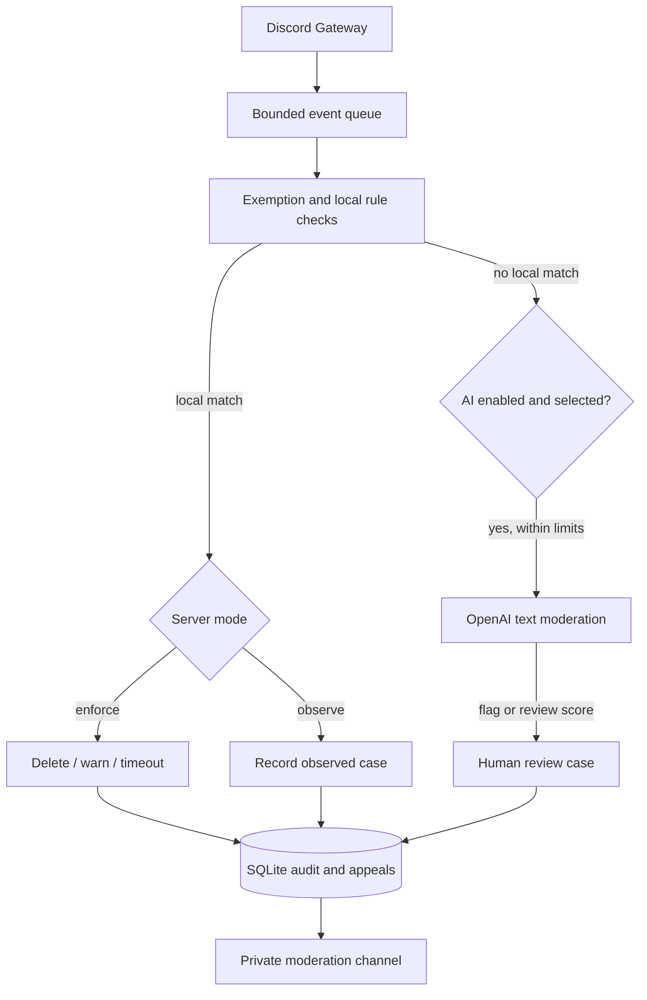

# Research and implementation decisions

Research date: **13 November 2026**. Scope: the supplied Discord moderation blueprint, its implementation requirements, and operational constraints. Official documentation and original research were used to check the blueprint. Product comparisons and uncited community claims in the pasted text were not treated as evidence.

## Findings that change the blueprint

| Topic | Verified finding | Implementation decision |
|---|---|---|
| Privileged intent review | Discord's June 2026 update replaces the old 100-server threshold with 10,000 unique users who can access the app across its servers, and introduces annual reapplication for previously approved access. | Request Message Content only; document the current review process. |
| Message Content timing | Message Content is an existing privileged intent, not a feature first introduced in 2026. | Enable it explicitly in code and the portal; avoid claiming a new 2026 introduction. |
| Slash-command authorization | Default command permissions are a visibility/default hint and may be changed by administrators. | Apply runtime permission checks as well as default permissions. |
| Role hierarchy | Permission flags alone do not establish that a bot can kick/ban a target. | Validate bot and moderator roles and re-fetch member information for manual actions, including after confirmations. |
| AI categories | Moderation returns categories and scores; there is no universal calibrated “ban above 0.8” rule. | Route AI results to human review; keep automatic enforcement local and explicit. |
| Self-harm | A detection category does not establish misconduct by the author. | Create a supportive moderator review case and apply no automated punishment. |
| Multilingual accuracy | Hindi-English code mixing has its own annotated corpora and evaluation problems. | Provide editable Hindi/Hinglish phrase rules and regression cases, without claiming measured language-wide accuracy. |
| Data practices | Sending content to an inference provider is a separate processing step from local filtering. | Require global enablement and per-server opt-in; disclose the data flow and keep AI off by default. |

The intent-review threshold and annual process above come from [Discord's 2026 change notice](https://support-dev.discord.com/hc/en-us/articles/40281523410967-Changes-to-Privileged-Intent-Access-for-Discord-Apps). Intent behavior is documented in the [Gateway specification](https://docs.discord.com/developers/events/gateway). Runtime checks and default-permission behavior are described in the [discord.py interaction reference](https://discordpy.readthedocs.io/en/stable/interactions/api.html). Role restrictions are documented in [Discord permissions](https://docs.discord.com/developers/topics/permissions).

## Stack and architecture

Python with discord.py matches the blueprint and allows async Gateway handling and an async classifier in one process. The dependency lock produced for this delivery resolves discord.py **2.7.1** and OpenAI **2.54.0**. These are the versions verified locally; the project metadata permits compatible future releases, while the shipped requirements files pin the current resolution. Python 3.11 is the minimum because the implementation uses standard-library features available from that version, including atomic regular-expression groups.

The Gateway supplies messages and interactions; no public HTTP interactions endpoint or incoming port is required. The bot requests Guilds, Guild Messages, and Message Content. It does not track presence, joins, or member lists. discord.py documents that a server message's author can be a Member without enabling a member cache. Explicit member fetches support command checks and old edited messages. [discord.py intents and member caching](https://discordpy.readthedocs.io/en/stable/intents.html)

The queue, rolling histories, cooldown map, and classifier cache have fixed limits. Overload is observable: skipped events and checks increment health counters. Four event workers and two concurrent classifier calls are modest starting defaults, not a tested capacity claim. Per-member lock stripes serialize actions without retaining an unbounded number of locks.

SQLite is appropriate for the delivered single-process deployment. It uses WAL, foreign keys, parameterized SQL, a schema version, and a shared async transaction lock. A case is written before a destructive request. An interrupted action is marked unknown at the next startup and never automatically retried. Scaling to multiple bot processes requires shared state, durable request budgets, database migrations beyond schema v1, and coordinated/sharded Gateway ownership; adding more replicas to this Compose file is not supported.

## Moderation design

Local checks catch explicit server rules: message rate, duplicate text, same text across multiple channels, mentions, invite links, blocked hosts, and configured phrases. Normalization preserves Devanagari combining marks. Word boundaries reduce substring false positives. Longer Latin terms accept bounded obfuscations; atomic repetitions prevent pathological backtracking for repeated-character phrases. This is a practical filter, not general transliteration or semantic analysis. Some confusables, inflections, deliberate misspellings, context, quotations, and new slang will be missed or misclassified.

The primary-source [HECM corpus paper](https://aclanthology.org/2024.icon-1.9/) describes approximately 9,400 Hindi-English posts labeled for hate detection, supporting separate evaluation of code-mixed content. It does not establish this bot's accuracy. The dataset was not downloaded, bundled, or used to train a model.

OpenAI's documented standalone endpoint accepts text through `moderations.create` and returns category flags and scores. The supplied model alias is `omni-moderation-latest`. The official guide warns that scores may require recalibration as underlying models change. These facts support the decision to use scores only for review routing. [OpenAI moderation guide](https://developers.openai.com/api/docs/guides/moderation), [Python API reference](https://developers.openai.com/api/reference/python/resources/moderations)

The endpoint and model are currently free to use, with account-dependent rate limits. Server hosting and operations can still cost money. The bot additionally sets process-level rate budgets, a concurrency cap, a short timeout, and an outage circuit. These controls limit demand but do not constitute a guaranteed billing cap across restarts or future provider pricing changes. [OpenAI model documentation](https://developers.openai.com/api/docs/models/omni-moderation-latest)

Native Discord AutoMod can block messages before they are posted, and supports keyword/mention rules and alert/timeout actions. This bot normally reacts after a message is posted. Configuring Discord AutoMod alongside it provides an independent layer during bot outages. Native AutoMod rules are not silently installed or modified by this project. [Discord Auto Moderation resource](https://docs.discord.com/developers/resources/auto-moderation)

Discord rate limits can vary by route and must be respected. discord.py manages ordinary Discord HTTP rate-limit behavior; the bot still avoids custom retry floods, unbounded queues, repeated command syncing on reconnects, and automatic retries of uncertain destructive operations. [Discord rate limits](https://docs.discord.com/developers/topics/rate-limits)

## Privacy and review tradeoffs

The bot stores IDs, action metadata, scores, moderator reasons, and submitted appeal text. It does not persist message bodies or copy offending content into logs. This reduces stored content but also means moderators may lose the original evidence after deletion. The audit keeps a message link, rule category, and action result; it does not promise recovery of deleted evidence.

Discord prohibits using API message content to train AI models without its express permission. This implementation does inference only and has no training pipeline. Operators should keep provider data-sharing/training opt-ins disabled for Discord message data and review their provider settings. [Discord Developer Policy](https://support-dev.discord.com/hc/en-us/articles/8563934450327-Discord-Developer-Policy)

OpenAI states that API inputs are not used for training by default unless the customer opts in. Retention is endpoint-specific and account controls matter; the current data-controls table lists `/v1/moderations` with no abuse-monitoring or application-state retention. Operators should verify that table and their account configuration when enabling the integration. [OpenAI data controls](https://developers.openai.com/api/docs/guides/your-data)

## Rollout and evaluation

Use a private test server first. Publish `/rules` and `/privacy` information before enabling enforcement or external processing. Test with an ordinary member account because staff are exempt. Start in observe mode and have bilingual moderators inspect phrase-rule flags, benign quotations, discussion of abuse, regional slang, and mixed-script messages.

For calibration, create a small synthetic or properly authorized evaluation set with separate English, Hindi, and Hinglish slices, and separate harmful/benign labels. Include code switching, punctuation, zero-width characters, usernames, sarcasm, quotations, reclaimed language, and reported abuse. Track precision, recall, false-positive examples, appeal reversals, queue drops, AI skips, and moderation latency. A passing software test suite does not measure these community outcomes.

Enable enforcement only after the actual server rules and examples have been reviewed. Review false positives and exemptions before broadening phrase lists. Keep AI review-only for this release. Re-check model behavior and dependency/security changes on updates. Live latency, multilingual classifier accuracy, host reliability, and final Discord permissions remain unmeasured until deployment with a real application and server.
